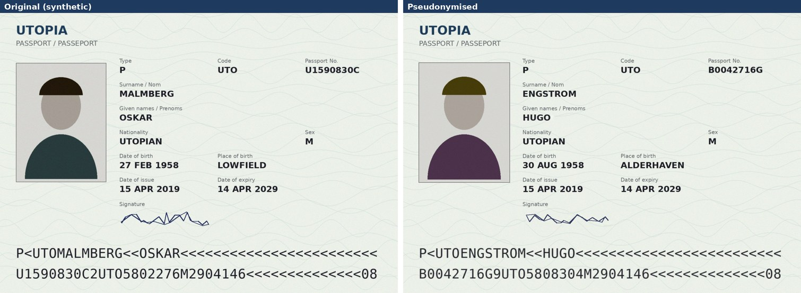
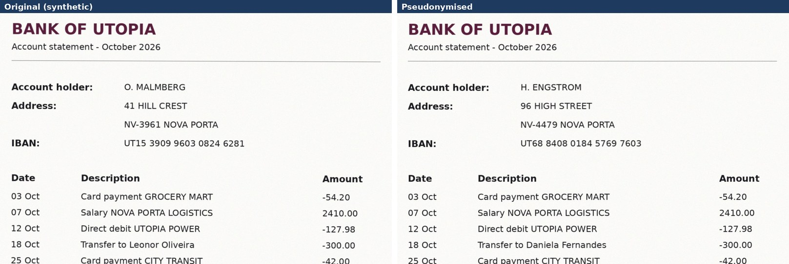
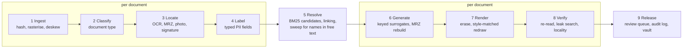

# kycpseudo

Pseudonymise scanned KYC documents. Personal details on the image are **replaced, not blacked out**: every name, number, date and address becomes a realistic stand-in, drawn in the document's own style, so the documents can still be processed downstream. The same person gets the same pseudonym on every document in the corpus, and every page is verified before release.





All documents shown are **synthetic**: fictional people from a fictional state (Utopia, code `UTO`, the state ICAO uses for its specimen documents). The repository contains no real identity documents.

## Why replace instead of redact

Redaction is easy: find the field, paint a box. But a redacted passport is useless for anything downstream: you can't test an extraction model on it, check that a proof of address matches an ID, or train on it. Pseudonymisation keeps the document usable and removes the person. That raises four requirements redaction never has to meet:

1. **No leak.** No original value readable anywhere: visual zone, MRZ, photo, signature, free text such as a transfer description.
2. **Exact surrogate.** The new text on the page is exactly the intended value.
3. **Consistency inside a document.** The MRZ agrees with the visual zone and its check digits validate.
4. **Consistency across the corpus.** One person, one pseudonym, on the passport, the utility bill and the bank statement, even when each spells the name differently.

## Pipeline



| Stage | What it does | Key choice, and why |
| --- | --- | --- |
| 1 Ingest | Hash, rasterise PDFs, deskew | Rasterising drops the hidden OCR text layer and metadata, a common leak. Deskew uses a shear-based projection profile accurate to about 0.04°, because residual tilt biases the font fit in stage 7. |
| 2 Classify | Passport, utility bill, statement, unknown | Rules over OCR text; unknown types go to review rather than being processed with the wrong rules. |
| 3 Locate | Words, MRZ, photo, signature | The MRZ is re-read with a character whitelist and **repaired using its own check digits**: candidate fixes are ranked by known OCR confusions (O/0, Q/0, I/1) and accepted only when exactly one validates. |
| 4 Label | Typed fields with boxes | Union of detectors: MRZ anchors (values from a validated MRZ searched in the visual zone), label rules, patterns, optional Presidio NER. Every value is then re-read from a closer crop. |
| 5 Resolve | Mentions → people | See below. |
| 6 Generate | One identity per person | HMAC-keyed choice from same-locale, same-sex, similar-length name lists. Numbers use **FF1 format-preserving encryption** (NIST SP 800-38G, tested against the NIST vectors). IBAN and MRZ check digits are recomputed. |
| 7 Render | Erase and redraw | Deterministic: the surrogate is drawn with a font, so the text is exact. Style is fitted by re-rendering the *original* text and matching it to the scan (see below). |
| 8 Verify | Prove each page | Re-read every field (character error rate), re-parse the new MRZ, search the page for every original token, and check that no pixel changed outside the edit boxes. |
| 9 Release | Out, review, vault | Passed pages are named by entity id, never by input filename. Failures go to a review queue and a Label Studio task file. Originals and the mapping go into a Fernet-encrypted vault. |

### Stage 5: one person across documents, and where BM25 fits

The same person appears as `MALMBERG<<OSKAR`, `Oskar Malmberg`, `O. MALMBERG` and, on another bill, `Etienne Thomas Dueois` (a data-entry typo). Exact matching splits these; per-mention random fakes would put different names on one investor's passport and bill.

1. **BM25 over character trigrams** retrieves candidate matches for each mention. Trigrams survive OCR slips (`GANTA` and `CANTA` share `ANT` and `NTA`), and BM25's IDF makes a rare surname dominate the score. Embeddings would be the wrong tool here: names have spelling, not meaning.
2. **Linking rules**, most trusted first: hard evidence (same date of birth, document number or address) with compatible names; full-name similarity at or above 0.92; initials-only matches (`O. MALMBERG`) **only if every candidate belongs to one person**.
3. **Conflict guard:** unions that would join different dates of birth or addresses are refused.
4. **Sweep:** after a first pass, names of known people are searched for in free text (`Transfer to Leonor Oliveira`) using every spelling seen for them, then resolved again.

The synthetic corpus deliberately contains Oskar and Olof Malmberg, both of whom appear as `O. MALMBERG`. Name similarity alone cannot separate them; their addresses do.

### Stage 7: matching the scan's style

For each field the original text is re-rendered and fitted to the scan to recover:

- **Font size**, measured at the 50% ink level so blur doesn't inflate it.
- **Horizontal scale and sub-pixel position.**
- **Blur.**
- **Ink colour**, solved by least squares given the blur.
- **Sensor noise.**

The surrogate is then drawn with the same parameters. Erasing removes whole ink strokes that sit mostly inside the box, including descenders hanging below it, and only synthesised pixels are written back. The fit residual becomes a style score; a poor fit, for example a wrong font, goes to review. Diffusion text editors (TextCtrl, AnyText) are left as a fallback hook only: they do not guarantee the exact string.

## Results on the synthetic corpus

33 documents (12 passports, 13 utility bills, 8 bank statements) for 13 fictional people, including the hard cases above.

| Metric | Result |
| --- | --- |
| Document type accuracy | 100% |
| Detection recall (all 172 PII values) | 100% |
| Entity resolution, pairwise precision / recall | 100% / 100% (13 entities for 13 people) |
| Documents with any original value readable, independent check | **0** |
| Fields rendered / mean character error rate on re-read | 172 / 0.003 |
| MRZ rebuilt with valid check digits | 12/12 |
| Pixels changed outside edit boxes | 0 |
| Released without human review | 32/33 (one passport's new MRZ did not read back cleanly, so it was held) |

The leak figure comes from `kycpseudo evaluate`, which does not trust the pipeline: it OCRs every output image again and searches for every true value from the generator's ground truth, including values the pipeline never detected. As a sanity check, running it with the original scans in place of the outputs flags 33 of 33 documents.

**What these numbers do not show.** The corpus is synthetic, the templates are few and known, and the fonts are available. Real KYC scans bring unseen layouts, worn and photographed documents, holograms, handwriting and many scripts. Treat these results as evidence that the mechanism works end to end, not as an accuracy claim for production. A second corpus (`--seed 3`) surfaced two weaknesses that are now fixed and covered by tests: a missed transfer recipient whose canonical spelling was a typo, and review noise from same-surname pairs.

## Quick start

```bash
# Tesseract is required: apt install tesseract-ocr  /  brew install tesseract
pip install -e ".[dev,pdf]"

kycpseudo synth    --out data/synthetic --people 12          # fictional corpus + ground truth
kycpseudo run      --in data/synthetic/images --out runs/demo --demo-keys
kycpseudo evaluate --truth data/synthetic/truth.json --run runs/demo --demo-keys
kycpseudo reveal   --run runs/demo --entity P-0003 --demo-keys   # key holder only

pytest            # 43 tests; add -m "not slow" to skip the end-to-end and engine runs
```

`--demo-keys` creates throwaway keys in `.keys/`. For real use, set `KYCPSEUDO_HMAC_KEY` (base64, 32 bytes) and `KYCPSEUDO_VAULT_KEY` (a Fernet key) from a key management service, and keep the vault and keys apart from the released corpus.

Run outputs:

```
runs/demo/
  pseudonymised/      released pages, named <entity>_<type>_<keyed hash>.png
  review/             held pages + queue.jsonl + labelstudio_tasks.json
  audit.jsonl         what changed per page: types, boxes, checks (no values)
  vault.enc           originals and mapping, encrypted
  run_summary.json
```

## Web app

The whole pipeline runs inside a Streamlit app on Streamlit Community Cloud (`deploy/frontend/`). Anyone can try it on the synthetic samples or their own uploads; public outputs are **watermarked** and use throwaway keys. Clean output needs the operator's access token. The token holder may also choose the replacement name for a single person; every other value and the photo stay generated. The same service is also available as a FastAPI engine with a Dockerfile (`deploy/engine/`). Setup steps are in [deploy/README.md](deploy/README.md).

## Repository layout

```
src/kycpseudo/
  stages/s1_ingest.py ... s9_release.py   one module per stage
  mrz.py        ICAO 9303 TD3: check digits, build, parse, checksum-guided repair
  ff1.py        FF1 format-preserving encryption
  bm25.py       BM25 over character n-grams, with explain()
  names.py      normalisation, name similarity, pattern-preserving formatting
  evaluate.py   independent scoring against ground truth
  watermark.py  visible marking for public outputs
  service.py    one-call service with the public/operator access model
  synth/        synthetic corpus generator
tests/          MRZ, FF1 (NIST vectors), BM25, resolution, surrogates, rendering, engine, end to end
deploy/frontend/  Streamlit app (runs the pipeline itself)
deploy/engine/    optional FastAPI engine + Dockerfile
packages.txt      system packages for Streamlit Community Cloud
```

## Known limits and next steps

- **OCR engine:** Tesseract is the default because it installs anywhere. PaddleOCR (PP-OCRv5, Apache 2.0) is the production choice and plugs in behind `ocr.read_words`.
- **Faces:** the photo is replaced with a procedural placeholder per entity. A synthetic face generator, one face per entity, belongs in `render_region`.
- **Barcodes, PDF417 and QR codes** are not yet decoded and rebuilt.
- **Fonts:** OCR-B is bundled for the MRZ, and passport fields are fitted against OCR-B and the sans faces, keeping whichever reproduces the original best. Other typefaces need adding to the font registry per document template.
- **Real passports:** label rules cover English-first (UK, India), French-first (France) and trilingual (Luxembourg) layouts, with dates printed as `18 SEP /SEPT 99`, `12 07 1973` or `12/07/1973`. With a valid MRZ the name, number and date of birth are found from the MRZ values whatever the label language, and a value the MRZ proves is on the page but that could not be located sends the page to review. Tested on one specimen each for the UK (passes) and Luxembourg (all fields replaced; held for review on read-back). A 600 px French specimen is too small to read reliably and is held for review; no Indian specimen with visible values was available, so that layout is untested. Scans under 1400 px wide are enlarged, and the output keeps the enlarged size.
- **Photo:** a framed photo is found by its frame, an unframed one with the bundled YuNet face detector. A second, ghost portrait (as on French passports) is not yet replaced.
- **Free-text names of people outside the corpus** need NER (the optional Presidio hook); the sweep only finds people the corpus already knows.
- **Two different people with the same full name and no shared evidence** cannot be told apart by name; such cases are routed to review rather than guessed.
- **Quasi-identifiers:** date of birth is shifted per person; nationality, sex and expiry are kept on purpose. Which attributes to keep is a policy decision, set in `Config.keep_fields`.
- **Inpainting** on dense security patterns: OpenCV Telea by default, LaMa via `--lama`.

## Responsible use

Pseudonymised data is still personal data under GDPR, because the key holder can re-identify it ([EDPB Guidelines 01/2025](https://www.edpb.europa.eu/our-work-tools/documents/public-consultations/2025/guidelines-012025-pseudonymisation_en)). A tool that rewrites identity documents convincingly could also be misused. It belongs inside a restricted environment, with keys in a key management service, outputs registered and marked, and nothing exported beyond the project. Develop and demonstrate only on synthetic data.

## License

MIT
